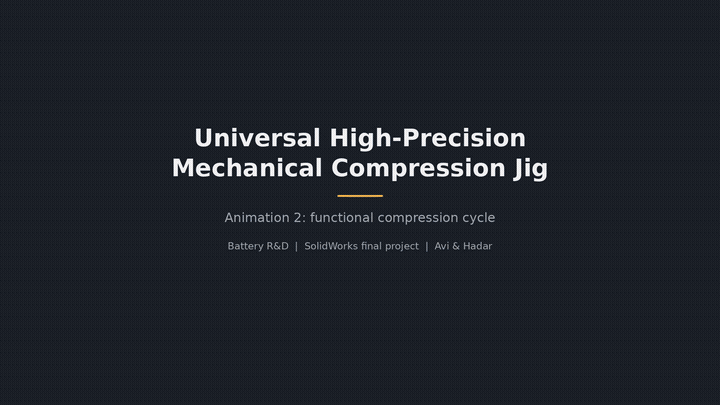
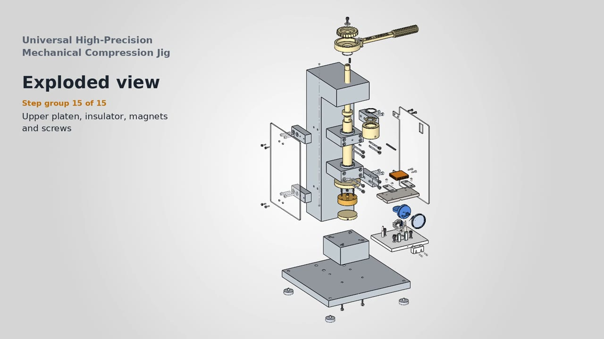
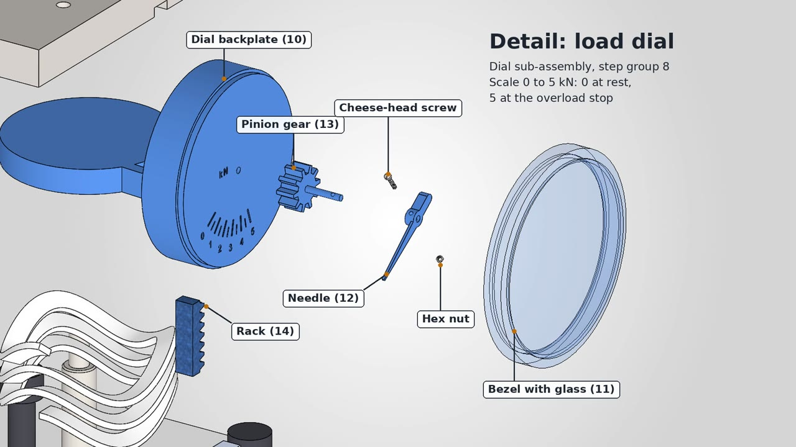

# Universal High-Precision Mechanical Compression Jig (Battery R&D)

A hand-operated compression jig for applying controlled stack pressure to multi-layer battery samples, designed in **SOLIDWORKS 2026**. Built as the final project for *Computer Graphics for Materials Engineering* at the Technion (Spring 2026) by **Avi** and **Hadar**.

## Key features

- **Ratcheting lead-screw drive.** A lever arm with a selectable spring-loaded pawl drives a 3 mm-lead screw, so each 120° stroke moves the ram 1 mm.
- **Built-in load dial (0–5 kN).** The lower platen rides on a wave spring, and a rack and pinion converts its deflection into a needle reading. A hard overload stop sits at the 5 kN mark.
- **Electrically isolated sample stack.** Insulated upper and lower platens plus a terminal contact block allow electrical measurements on the sample while it is under load.
- **Guided ram.** The ram runs in upper and lower guide blocks with guide bars and a stop pin to keep the platens parallel.
- **Operator safety.** Left and right safety shields enclose the compression zone.

| Exploded view | Load dial detail |
|---|---|
|  |  |

## Project scope

- 38 part numbers, covering custom parts plus ISO/DIN standard hardware.
- 4 sub-assemblies: Lower Stack, Upper Stack, Ratchet Drive and Dial Indicator.
- A 47-step exploded view saved in the main assembly.
- A full drawing set of 62 sheets, including the general assembly, an exploded BOM and a drawing for every part.
- Three rendered animations: the exploded and collapsed view, the functional compression cycle, and both combined.

Envelope: approx. 420 × 314 × 780 mm.

## Repository contents

| Path | Description |
|---|---|
| `CompressionJig_Assembly.SLDASM` | Main assembly (open this) |
| `SUB_*.SLDASM` | Sub-assemblies |
| `CompressionJig_Assembly.SLDDRW` | Assembly drawing: views, exploded BOM, hardware |
| `CompressionJig_Drawings.pdf` | [All 62 drawing sheets in one PDF](CompressionJig_Drawings.pdf) |
| `Parts/` | Part files (`34_*`, `35_*` are standard purchased hardware) |
| `Drawings/` | One drawing per part |
| `Animations/` | MP4 animations |

Keep the folder structure intact, because the assemblies reference parts in `Parts/`.
